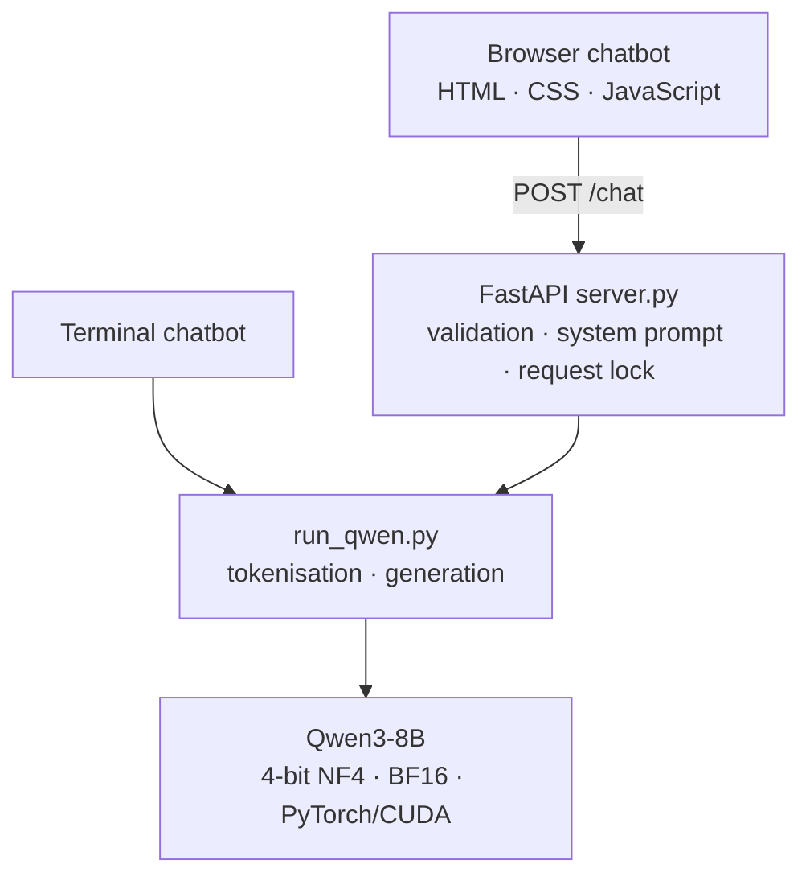

# Qwen3-8B — Local AI Chatbot

A local language-model application built with **Python, PyTorch, Hugging Face Transformers and FastAPI**. It runs pretrained **Qwen3-8B** weights on an NVIDIA GPU using **4-bit NF4 quantisation**, and provides both a terminal chatbot and a browser interface.

**Local model inference · CUDA acceleration · No hosted LLM API · Multi-turn chat**

> [!NOTE]
> This repository contains the **application source**, not Qwen's pretrained model weights or a hosted demo. To run the chatbot, supply the model files and a compatible local NVIDIA/Python environment as described below.

## What it does

| Component | Implementation |
| --- | --- |
| **Model** | Qwen3-8B, loaded from local files through Hugging Face Transformers |
| **Inference** | PyTorch with BitsAndBytes NF4 4-bit weights and BF16 computation |
| **Terminal app** | Interactive, multi-turn CLI in `run_qwen.py` |
| **HTTP API** | FastAPI `POST /chat`, with validated conversation messages |
| **Browser app** | Dependency-free HTML, CSS and JavaScript with a small Markdown renderer |
| **Privacy model** | Local inference and loopback-bound development servers; no external LLM API |

## Architecture



The two interfaces share one inference implementation. The browser sends its conversation history to the local API; the API validates the messages, prepends its system prompt and calls the model. The model is loaded **once per API process**, and API generations are serialised to avoid concurrent use of the same model instance.

The browser keeps conversation context only for the current page session. The server does not maintain user chat history between requests or provide user accounts.

## Running locally (Windows + NVIDIA)

### Requirements

- **Python 3.12** (the documented local setup used Python 3.12.10).
- A compatible **NVIDIA GPU**, driver and CUDA-enabled PyTorch installation.
- A complete local copy of the **Qwen3-8B** model (weights, configuration and tokenizer).
- Python dependencies listed in [`requirements.txt`](requirements.txt).

The documented setup used **PyTorch 2.13.0+cu130**. CUDA wheels are platform-specific: choose the appropriate installation command from the [official PyTorch selector](https://pytorch.org/get-started/locally/) rather than assuming a generic `pip install torch` selects the right build.

### 1. Prepare the environment and model

From the repository root in PowerShell:

```powershell
py -3.12 -m venv qwen-env
.\qwen-env\Scripts\Activate.ps1
python -m pip install --upgrade pip

# Install a compatible CUDA-enabled PyTorch build first (see link above).
python -m pip install -r requirements.txt
```

Place your complete downloaded model at:

```text
models/
└── Qwen3-8B/
    ├── config.json
    ├── tokenizer_config.json
    └── ... model weights and tokenizer files
```

The loader uses `local_files_only=True`; it **does not download missing weights at runtime**. The `models/` and `qwen-env/` directories are excluded from Git.

### 2. Start the terminal chatbot

```powershell
.\qwen-env\Scripts\python.exe .\run_qwen.py
```

Type at the `You:` prompt. Enter `quit` or `exit` to leave. The program prints the detected model architecture, parameter count, quantisation mode and device at startup.

### 3. Start the browser chatbot

Open **two PowerShell terminals** in the repository root.

**Terminal A — API:**

```powershell
.\qwen-env\Scripts\python.exe -m uvicorn server:app --host 127.0.0.1 --port 8000 --workers 1
```

**Terminal B — static web server:**

```powershell
.\qwen-env\Scripts\python.exe -m http.server 5500 --bind 127.0.0.1 --directory web
```

Visit **http://127.0.0.1:5500/**. Keep both terminals open while using the chat. Do not enable multiple Uvicorn workers or automatic reload for this setup: each worker could load another copy of the model.

## API contract

**Request:** `POST http://127.0.0.1:8000/chat`

```json
{
  "messages": [
    { "role": "user", "content": "When was the Eiffel Tower completed?" },
    { "role": "assistant", "content": "It was completed in 1889." },
    { "role": "user", "content": "What event was it built for?" }
  ]
}
```

**Response shape:**

```json
{ "response": "...model-generated text..." }
```

The conversation must be nonempty, alternate `user`/`assistant` roles, start with a user message and end with a user message. Invalid requests receive validation errors. The browser sends the complete session history on each turn, and restores the draft if an API request fails.

Only the local browser origins `127.0.0.1:5500` and `localhost:5500` are CORS-allowed. The server is intended for **local development**, not deployment on the public internet.

## Implementation details

- **Generation:** Qwen's chat template is applied with `enable_thinking=False`, followed by sampled decoding (`temperature=0.7`, `top_p=0.8`, `top_k=20`).
- **Output handling:** The script decodes only newly generated tokens, checks for a normal end-of-sequence token and rejects visibly incomplete thinking output.
- **UI:** Multi-turn history, Enter-to-send / Shift+Enter newline, loading/error states, responsive layout and safe text-node-based rendering of a limited Markdown subset.
- **Separation:** `run_qwen.py` can run alone in the terminal; `server.py` reuses its loader and generator without duplicating model code.

### Source layout

```text
run_qwen.py             Local model loading, text generation and terminal chat
server.py               FastAPI /chat endpoint and request validation
web/
  index.html            Standalone browser chat
  style.css             Responsive UI styling
  app.js                API calls, chat state and safe Markdown rendering
requirements.txt        Runtime dependencies
requirements-test.txt   Lightweight API-test dependencies
tests/test_api.py       Tests with a stubbed model (no GPU required)
.github/workflows/      CI for lightweight API tests
```

The same `/chat` API is also used by an Eiffel Tower school-website integration maintained in a separate project; its source is not included here.

## Tests

The lightweight tests cover the API request contract, system-prompt forwarding, invalid conversations and CORS. They **stub model loading and inference**: they do not test CUDA performance or the actual Qwen responses, and they require no downloaded model weights.

```powershell
.\qwen-env\Scripts\python.exe -m pip install -r requirements-test.txt
.\qwen-env\Scripts\python.exe -m unittest discover -s tests -v
```

GitHub Actions runs these lightweight checks on pushes and pull requests.

## Current limitations

- No token streaming; the browser displays each reply when generation finishes.
- Chat history lives in memory and clears on refresh; no persistent accounts or storage.
- The full conversation is resent for each turn without context-window truncation.
- Single-user, loopback-only prototype; **not** a public hosted service.
- No fine-tuning, retrieval-augmented generation or external tool access.

A `triton not found; flop counting will not work for triton kernels` warning has appeared in the documented Windows setup. It concerns optional FLOP accounting; it did not prevent local inference in that environment.

## Project scope

This project demonstrates **local deployment and application integration of an existing LLM**, not training a new model from scratch. Pretrained Qwen weights are not redistributed here. The model, Python environment, caches and local configuration remain outside version control.